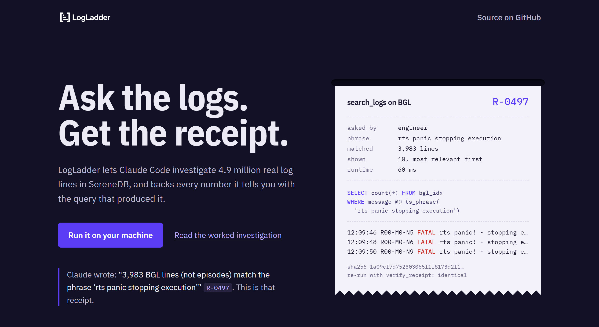

<p align="center">
  <picture>
    <source media="(prefers-color-scheme: dark)" srcset="docs/brand/logladder-horizontal-white.svg">
    
  </picture>
</p>

<p align="center">
  <a href="https://vedant-bhagat.github.io/logladder-mcp/"></a>
</p>

<p align="center">
  <a href="docs/investigation.md">Worked investigation</a> &nbsp;|&nbsp; <a href="docs/validation.md">Validation</a> &nbsp;|&nbsp; <a href="docs/slides/index.html">Slides</a> &nbsp;|&nbsp; <a href="docs/tools.md">Tools</a>
</p>

<p align="center"><sub>Built with</sub></p>

<table align="center">
  <tr>
    <td align="center" width="96">
      <picture>
        <source media="(prefers-color-scheme: dark)" srcset="https://cdn.simpleicons.org/python/white">
        
      </picture>
      <br><sub>Python</sub>
    </td>
    <td align="center" width="96">
      <picture>
        <source media="(prefers-color-scheme: dark)" srcset="https://cdn.simpleicons.org/fastapi/white">
        
      </picture>
      <br><sub>FastAPI</sub>
    </td>
    <td align="center" width="96">
      <picture>
        <source media="(prefers-color-scheme: dark)" srcset="https://cdn.simpleicons.org/typescript/white">
        
      </picture>
      <br><sub>TypeScript</sub>
    </td>
    <td align="center" width="96">
      <picture>
        <source media="(prefers-color-scheme: dark)" srcset="https://cdn.simpleicons.org/modelcontextprotocol/white">
        
      </picture>
      <br><sub>MCP</sub>
    </td>
    <td align="center" width="96">
      <picture>
        <source media="(prefers-color-scheme: dark)" srcset="https://cdn.simpleicons.org/claude/white">
        
      </picture>
      <br><sub>Claude Code</sub>
    </td>
    <td align="center" width="96">
      <picture>
        <source media="(prefers-color-scheme: dark)" srcset="docs/brand/serenedb-white.svg">
        
      </picture>
      <br><sub>SereneDB</sub>
    </td>
    <td align="center" width="96">
      <picture>
        <source media="(prefers-color-scheme: dark)" srcset="https://cdn.simpleicons.org/docker/white">
        
      </picture>
      <br><sub>Docker</sub>
    </td>
  </tr>
</table>

<hr>

## What it is

LogLadder turns a pile of raw logs into answers you can check. You ask Claude Code a question in plain words ("what broke last night, and who did it hit?"). Claude picks the steps, and our `loglad` MCP server runs them inside SereneDB over the BGL and OpenStack logs. Every number that comes back carries a **receipt** (`R-xxxx`) that shows the exact query behind it, so nobody has to take the answer on trust.

A live **console** sits next to Claude and shows the evidence as it arrives: charts, tables and a plain-language explanation that fits who is asking.

## How it works

LogLadder climbs the evidence ladder one rung at a time, and each rung keeps a link to the one below it.

| Rung | What you get |
| --- | --- |
| **Lines** | the raw log lines, searchable and filtered |
| **Templates** | lines grouped into repeated message patterns |
| **Episodes** | bursts of related events, in time order |
| **Risks** | what to fix first, scored from measured numbers only |

Same data, different altitude. An **engineer** works at the bottom of the ladder, a **team lead** in the middle and a **manager** at the top, and any claim at the top can be drilled down to the exact lines behind it.

## Where SereneDB does the work

Claude never reads the logs directly. Every tool is a SQL query that [SereneDB](https://serenedb.com) runs, and that query is what the receipt stores.

- **Search:** one inverted index per dataset gives phrase, keyword and typo-tolerant search ranked by BM25, plus highlight offsets for the console. A search over all 4.7M BGL lines takes 6–11 ms.
- **Load:** SereneDB reads our Parquet files directly and assigns episodes with window functions during the insert. The whole SQL load takes about 15 s.
- **Analysis:** the counts, weekly trends, percentiles and risk inputs are all aggregates computed in the database, so only small results reach Claude.

## Quick start

You need Python 3.11+, Node 20+, Docker Desktop and [Claude Code](https://docs.anthropic.com/en/docs/claude-code).

```bash
python tasks.py setup            # virtual env + pinned packages
python tasks.py db               # start SereneDB in Docker (Docker Desktop must be running)
python tasks.py fetch            # download BGL + OpenStack from Loghub/Zenodo (~65 MB, ~800 MB unpacked)
python tasks.py data             # parse, mine templates, load SereneDB: ~5 minutes, 4.95M lines
python tasks.py console          # open the console with Claude inside it
```

In a hurry? `python tasks.py data --sample` loads 2,000 lines of each log in seconds instead of `fetch` + `data`. Everything works, but the answers are thin.

**Dependencies.** Python packages are pinned in [`pyproject.toml`](pyproject.toml) (`mcp`, `psycopg`, `pyarrow`, `drain3`, `fastapi`, …) and installed by `setup`; the console's JavaScript packages are pinned in [`console/package.json`](console/package.json) and installed on its first run.

### Use an existing SereneDB instead of Docker

Skip `python tasks.py db` and point LogLadder at the instance you were given, in a `.env` file at the repo root (copy [`.env.example`](.env.example)):

```bash
SERENEDB_DSN=postgresql://<user>:<password>@<host>:<port>/
LOGLAD_PARQUET_DIR=/path/the/server/can/read   # where that server sees data/parsed/
```

The loader writes Parquet files to `data/parsed/` and asks SereneDB to read them with `read_parquet`, so the server needs to see that folder: mount or copy it there, and set `LOGLAD_PARQUET_DIR` to its path on the server. Then run `fetch` and `data` as above.

### Connect the MCP server

Claude Code picks up [`.mcp.json`](.mcp.json) when you start `claude` in the repo root; approve the `loglad` server and check it with `/mcp`. Anywhere else, register it once:

```bash
claude mcp add loglad -- python /path/to/logladder-mcp/tasks.py mcp
```

The server talks over stdio and reads `SERENEDB_DSN` from `.env`. It exposes 14 tools, the prompts `/mcp__loglad__engineer`, `team_lead`, `manager`, `investigate`, and 4 resources (schema, ownership, answer contract, glossary). Inputs and outputs of every tool: [`docs/tools.md`](docs/tools.md).

## Try it

Pick a role in the console (or type `/mcp__loglad__engineer`, `/mcp__loglad__team_lead`, `/mcp__loglad__manager`), then ask:

- **Engineer:** "What happened on midplane R20-M0 in the hour before the first FATAL kernel error on 2005-06-05?"
- **Team lead:** "Which problems recurred most in the last 4 weeks of BGL, by episodes, per team?"
- **Manager:** "Across both systems, what are the top 3 risks right now and what should we do about each?"
- **All three at once:** `/mcp__loglad__investigate Why does BGL keep logging 'rts panic! - stopping execution'?`
- **The honesty test:** "How much downtime did this cause?" The logs don't record downtime, and Claude says so instead of inventing a number.

## Results

| Check | Result |
| --- | --- |
| Lines loaded | 4,955,783 (BGL 4,747,963 + OpenStack 207,820), matching the brief, 0 rejected |
| Tool choice | 15 of 15 scripted questions: Claude called the expected tools |
| Reproducibility | 29 of 29 investigation receipts re-run to an identical result |
| Honesty | Asked about downtime and cost, Claude says the logs don't record them |
| Query time | Every tool runs on the full 4.95M lines in under 150 ms (p95 per tool, from the receipts) |
| Claude cost | Median 52 s and $0.47 per question across 18 recorded `claude -p` runs |

- [`docs/investigation.md`](docs/investigation.md): the worked investigation through all three roles, on BGL (`rts panic`) and OpenStack (nova-compute errors): Claude's answers, every tool call, receipt, data scope, truncation and SQL.
- [`docs/validation.md`](docs/validation.md): load integrity, episode sensitivity, label overlap, receipt reproducibility, answer grounding, tool selection, and query times and cost on the full data, all generated from queries.
- [`docs/tools.md`](docs/tools.md): the 14 tools, 4 prompts and 4 resources.

Regenerate them with `python tasks.py investigate`, `export-investigation`, `tool-selection` and `validation` (these call Claude Code).

## Known limitations

- Timestamps are as logged; there is no time-zone conversion.
- Teams and owners are fictional, mapped from components (`ownership` table); 319 BGL lines have a malformed component and count as `Unowned`.
- The logs record events, not outages: LogLadder will not state downtime, cost or customer impact.
- `test_hypothesis` measures precedence (lift), not cause.
- SereneDB crashes on `ORDER BY BM25(...) DESC, <second key>`, so search results are ranked by BM25 alone and equal scores may come back in any order.
- Run one Claude session at a time: concurrent sessions can hand out the same receipt ids.

## Run the console

```bash
python tasks.py console
```

The first run installs what the console needs, builds it and opens **http://127.0.0.1:7777**. Claude Code runs in a terminal on the left; the evidence and the explanation fill the right side as Claude works.

- **Pick a role** (Engineer, Team lead, Manager): Claude stops, clears the conversation and starts fresh in that role.
- **Click a receipt** (`R-xxxx`) to see the query behind a number.
- **Hide the terminal** with the icon beside the logo, or Ctrl/Cmd + Shift + F, so the evidence fills the screen.

Prefer your own terminal? Run `claude` in the repo root and the `loglad` MCP server starts from `.mcp.json`. Settings and details are in [`console/README.md`](console/README.md).

## For the team

1. Read [`docs/specs/00-team-contract.md`](docs/specs/00-team-contract.md) first: who owns what, the interfaces and the git rules.
2. Then your own spec in [`docs/specs/`](docs/specs/) and your agent's prompt in [`instructions/`](instructions/).
3. Frozen interfaces and fixtures live in [`contracts/`](contracts/).

Before every push, run `python tasks.py check` (contract tests, unit tests and ruff). It must pass on every branch.

| Who | Owns |
| --- | --- |
| **Vedant** | data, SereneDB and integration |
| **Janhavi** | MCP tools and reasoning |
| **Ayoub** | console and slides |

<p align="center"><sub>Built for the National AI Hackathon 2026.</sub></p>
