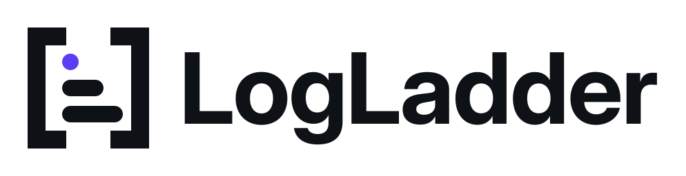

<p align="center">
  <picture>
    <source media="(prefers-color-scheme: dark)" srcset="docs/brand/logladder-horizontal-reversed.svg">
    
  </picture>
</p>

<p align="center">
  <b>Ask your logs a question. See the proof next to the answer.</b><br>
  Evidence-first log investigation with Claude Code, for engineers, team leads and managers.
</p>

<p align="center">
  
  
  
  
  
  
  
  
</p>

<hr>

## What it is

LogLadder turns a pile of raw logs into answers you can check. You ask Claude Code a question in plain words ("what broke last night, and who did it hit?"). Claude picks the steps, and our `loglad` MCP server runs them inside SereneDB over the BGL and OpenStack logs. Every number that comes back carries a **receipt** (`R-xxxx`) that shows the exact query behind it, so nobody has to take the answer on trust.

A live **console** sits next to Claude and shows the evidence as it arrives: charts, tables and a plain-language explanation that fits who is asking.

## How it works

LogLadder climbs the evidence ladder one rung at a time, and each rung keeps a link to the one below it.

| Rung | What you get |
| --- | --- |
| **Lines** | the raw log lines, searchable and filtered |
| **Templates** | lines grouped into repeated message patterns |
| **Episodes** | bursts of related events, in time order |
| **Risks** | what to fix first, scored from measured numbers only |

Same data, different altitude. An **engineer** works at the bottom of the ladder, a **team lead** in the middle and a **manager** at the top, and any claim at the top can be drilled down to the exact lines behind it.

## Quick start

You need Python 3.11+, Node 20+, Docker Desktop and [Claude Code](https://docs.anthropic.com/en/docs/claude-code).

```bash
python tasks.py setup            # virtual env + pinned packages
python tasks.py db               # start SereneDB in Docker
python tasks.py data --sample    # load the sample logs
python tasks.py console          # open the console with Claude inside it
```

For the full dataset, run `python tasks.py fetch` and then `python tasks.py data`.

## Run the console

```bash
python tasks.py console
```

The first run installs what the console needs, builds it and opens **http://127.0.0.1:7777**. Claude Code runs in a terminal on the left; the evidence and the explanation fill the right side as Claude works.

- **Pick a role** (Engineer, Team lead, Manager): Claude stops, clears the conversation and starts fresh in that role.
- **Click a receipt** (`R-xxxx`) to see the query behind a number.
- **Hide the terminal** with the icon beside the logo, or Ctrl/Cmd + Shift + F, so the evidence fills the screen.

Prefer your own terminal? Run `claude` in the repo root and the `loglad` MCP server starts from `.mcp.json`. Settings and details are in [`console/README.md`](console/README.md).

## For the team

1. Read [`docs/specs/00-team-contract.md`](docs/specs/00-team-contract.md) first: who owns what, the interfaces and the git rules.
2. Then your own spec in [`docs/specs/`](docs/specs/) and your agent's prompt in [`instructions/`](instructions/).
3. Frozen interfaces and fixtures live in [`contracts/`](contracts/).

Before every push, run `python tasks.py check` (contract tests, unit tests and ruff). It must pass on every branch.

| Who | Owns |
| --- | --- |
| **Vedant** | data, SereneDB and integration |
| **Janhavi** | MCP tools and reasoning |
| **Ayoub** | console and slides |

<p align="center"><sub>Built for the National AI Hackathon 2026.</sub></p>
